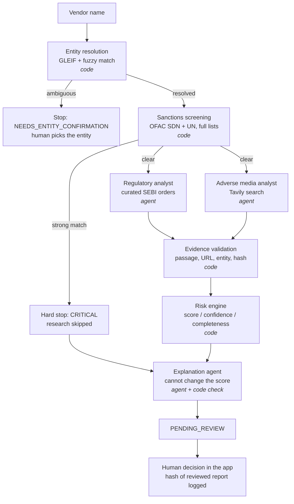

# Vendor Risk Screening: evidence-first multi-agent due diligence (CrewAI)

> Working name. Check name availability before publishing.

A decision-support system for vendor onboarding. Given a company name, it resolves the legal entity, screens it against the full OFAC and UN sanctions lists, runs two research agents in parallel (regulatory orders and adverse media), **verifies every agent claim against a stored copy of its source**, scores risk with **deterministic rules**, has an LLM explain that score without being able to change it, and stops for a **human decision** that is written to a hash-chained audit log.

**Agents investigate. Code verifies and scores. An LLM explains. A human decides.**

## Why this design

Many "AI vendor risk" demos have an LLM search the web and output a 0–100 score. This project takes the opposite approach on the points that matter in compliance:

| Problem with LLM-only scoring | What this system does |
|---|---|
| Hallucinated or misattributed claims | Each finding must quote a passage that is fuzzy-matched against the stored source text. The source must mention the resolved entity. Claims that fail are rejected and shown to the reviewer, never scored. |
| Allegations treated like convictions | Six evidence types (official finding, settlement, under appeal, media confirmed, media allegation, unverified) with different weights. Unverified claims score 0. |
| "Nothing found" read as "clean" | Score, **evidence confidence** and **source completeness** are separate. A failed source with no findings gives `INSUFFICIENT`, not `LOW`. |
| Score not reproducible or explainable | The score is a pure function of verified findings and `config/rules.yaml`. Every point traces to a finding and a rule. |
| LLM narrative contradicts the number | The explainer runs *after* scoring. A deterministic check flags any different score or band, invented finding ids, or "safe to onboard" language when evidence is insufficient. |
| Sources change or vanish | Everything an agent reads is stored first as a content-addressed snapshot (full SHA-256). Evaluations can be replayed on identical inputs. |

## Architecture



- The **CrewAI Flow** (`orchestration/crewai_impl/flow.py`) uses `@router` gates for identity and sanctions. The two research crews run as **concurrent async branches** joined with `and_()`.
- **Human review happens in the app, not inside the Flow.** The Flow ends at `PENDING_REVIEW`, and `core/reporting.record_decision` stores the decision together with the SHA-256 of the exact report the reviewer saw. CrewAI's `@human_feedback` blocks on console input by default, and its `learn=True` mode can alter the output before the reviewer sees it, which is wrong for an audit use case.
- **Framework independence:** `core/` has no agent-framework imports. An orchestrator only has to implement `assess_vendor(VendorInput) -> AssessmentReport` (`orchestration/base.py`). The single-agent baseline and a future LangGraph version reuse the same identity, sanctions, validation, scoring and reporting code, so a comparison measures the orchestration only.

```
core/                    framework-free business logic (all deterministic)
  schemas.py             data contracts
  entity_resolver.py     GLEIF lookup/search + rapidfuzz, auto-accept only with a clear margin
  sanctions_matcher.py   OFAC SDN (+aliases), UN consolidated, synthetic test list
  sources.py             Tavily search (cached, replayable), curated documents, untrusted-content wrapping
  snapshot_manager.py    content-addressed source store with integrity check
  evidence_validator.py  claim-to-source verification + cross-source de-duplication
  risk_engine.py         rules → score, band, confidence, completeness, contributions
  explanation_check.py   deterministic check of the LLM explanation
  audit.py               hash-chained JSONL audit log
  pipeline.py            shared steps used by every orchestrator
orchestration/crewai_impl/
  tools.py agents.py flow.py orchestrator.py   (multi-agent Flow + single-agent baseline)
app.py                   Streamlit review UI
eval/                    gold standard + benchmark harness
config/rules.yaml        every weight and threshold
tests/                   41 tests, no network or LLM needed
```

## Quick start

```bash
python -m venv .venv && source .venv/bin/activate      # Python 3.10–3.13
pip install -r requirements.txt
cp .env.example .env                                    # add an LLM key and TAVILY_API_KEY
python -m pytest                                        # 41 tests, offline
python -m scripts.download_sanctions                    # full OFAC + UN lists
python -m scripts.download_sanctions --check            # confirm entry counts
streamlit run app.py
```

CLI: `python -m scripts.assess "Company Name" [--lei LEI] [--orchestrator single] [--no-validate]`

Try the synthetic cases, which need no real company:
`python -m scripts.assess "ZZ-SYNTHETIC Sanctioned Trading LLC" --confirmed` (hard stop)
`python -m scripts.assess "ZZ-SYNTHETIC Injection Test Ltd" --confirmed` (document with a planted prompt injection)

## Evaluation

```bash
python -m eval.run_eval --configs multi,single,multi-novalidate     # first run: live, fills the search cache
VRS_SEARCH_MODE=replay python -m eval.run_eval --configs multi,single,multi-novalidate
VRS_SEARCH_MODE=replay python -m eval.run_eval --configs multi --repeats 3   # consistency
```

Configurations compared on identical cached inputs:
- `multi`: CrewAI Flow, two specialist agents, with validation
- `single`: one generalist agent with all tools, same deterministic steps
- `multi-novalidate`: ablation that scores agent claims without verification

Metrics: finding recall, wrong-entity rate, unsupported-claim rate, entity accuracy, sanctions accuracy, band agreement, injection resistance, score standard deviation across repeats, tokens and seconds per assessment. Labelling instructions: [docs/LABELLING_GUIDE.md](docs/LABELLING_GUIDE.md).

### Results

_To be filled from `eval/results/*.md` after running. Report what you measure._

| metric | multi | single | multi-novalidate |
|---|---|---|---|
| finding_recall | | | |
| unsupported_rate | | | |
| wrong_entity_rate | | | |
| injection_resisted | | | |
| mean_tokens | | | |
| mean_seconds | | | |

## Limitations (deliberate MVP scope)

- **Coverage:** listed Indian companies; regulatory evidence comes from **manually curated** SEBI documents, so the regulatory agent extracts and classifies rather than discovers. Adverse media depends on Tavily's index.
- **Sanctions:** OFAC SDN and UN only (no EU, UK or India-specific lists yet). Organisations only; directors and owners are not screened.
- **Weights** in `rules.yaml` are design assumptions, not a validated industry model.
- **Prompt-injection defence** is layered (marked untrusted content, verification against stored text, deterministic scoring, explanation check), but an injected document can still make an agent *omit* a real finding. The S02 case measures exactly that.
- Not legal advice and not a substitute for a compliance team. Outputs about real companies should be reviewed before sharing.

## Roadmap

ESG analysis from BRSR reports · EU and UK sanctions lists and ownership screening · exposing `core/` tools as MCP servers · LangGraph implementation of `Orchestrator` for a framework comparison on the same benchmark.
