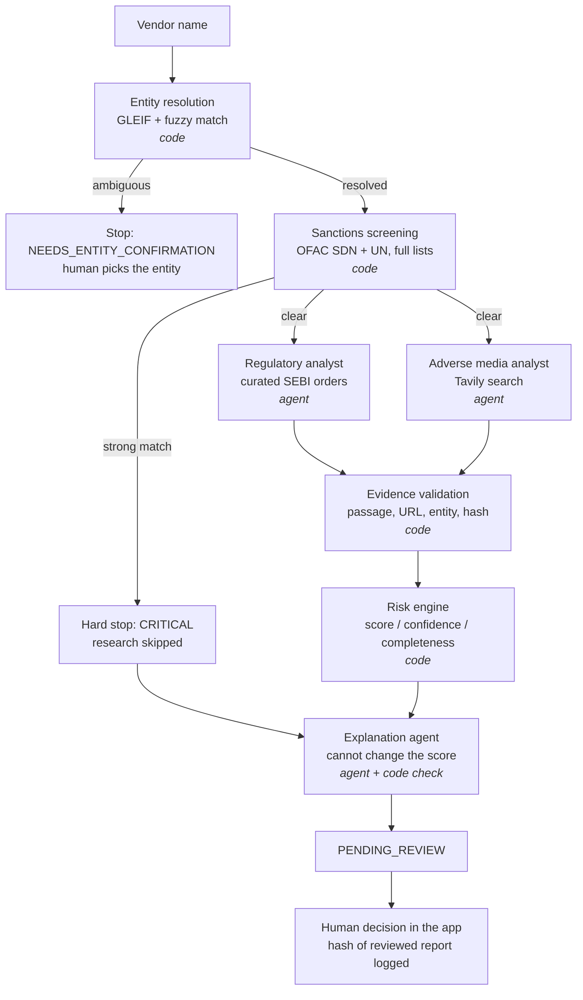

# Vendor Risk Screening: evidence-first multi-agent due diligence (CrewAI)

A decision-support system for vendor onboarding. Given a company name, it resolves the legal entity, screens it against the full OFAC and UN sanctions lists, runs two research agents in parallel (regulatory orders and adverse media), **verifies every agent claim against a stored copy of its source**, scores risk with **deterministic rules**, has an LLM explain that score without being able to change it, and stops for a **human decision** that is written to a hash-chained audit log.

**Agents investigate. Code verifies and scores. An LLM explains. A human decides.**

## Why this design

Many "AI vendor risk" demos have an LLM search the web and output a 0–100 score. This project takes the opposite approach on the points that matter in compliance:

| Problem with LLM-only scoring | What this system does |
|---|---|
| Hallucinated or misattributed claims | Each finding must quote a passage that is fuzzy-matched against the stored source text. The source must mention the resolved entity. Claims that fail are rejected and shown to the reviewer, never scored. |
| Allegations treated like convictions | Six evidence types (official finding, settlement, under appeal, media confirmed, media allegation, unverified) with different weights. Unverified claims score 0. |
| "Nothing found" read as "clean" | Score, **evidence confidence** and **source completeness** are separate. A failed source with no findings gives `INSUFFICIENT`, not `LOW`. |
| Score not reproducible or explainable | The score is a pure function of verified findings and `config/rules.yaml`. Every point traces to a finding and a rule. |
| LLM narrative contradicts the number | The explainer runs *after* scoring. A deterministic check flags any different score or band, invented finding ids, or "safe to onboard" language when evidence is insufficient. |
| Sources change or vanish | Everything an agent reads is stored first as a content-addressed snapshot (full SHA-256), so any run can be audited against exactly what the agent saw. |

## Architecture



- The **CrewAI Flow** (`orchestration/crewai_impl/flow.py`) uses `@router` gates for identity and sanctions. The two research crews run as **concurrent async branches** joined with `and_()`.
- **Human review happens in the app, not inside the Flow.** The Flow ends at `PENDING_REVIEW`, and `core/reporting.record_decision` stores the decision together with the SHA-256 of the exact report the reviewer saw. CrewAI's `@human_feedback` blocks on console input by default, and its `learn=True` mode can alter the output before the reviewer sees it, which is wrong for an audit use case.
- **Framework independence:** `core/` has no agent-framework imports. An orchestrator only has to implement `assess_vendor(VendorInput) -> AssessmentReport` (`orchestration/base.py`). The single-agent baseline and a future LangGraph version reuse the same identity, sanctions, validation, scoring and reporting code, so a comparison measures the orchestration only.

```
core/                    framework-free business logic (all deterministic)
  schemas.py             data contracts
  entity_resolver.py     GLEIF lookup/search + rapidfuzz, auto-accept only with a clear margin
  sanctions_matcher.py   OFAC SDN (+aliases), UN consolidated, synthetic test list
  sources.py             Tavily search (cached), curated documents, keyword search inside long documents, untrusted-content wrapping
  snapshot_manager.py    content-addressed source store with integrity check
  evidence_validator.py  claim-to-source verification + cross-source de-duplication
  risk_engine.py         rules → score, band, confidence, completeness, contributions
  explanation_check.py   deterministic check of the LLM explanation
  audit.py               hash-chained JSONL audit log
  pipeline.py            shared steps used by every orchestrator
orchestration/crewai_impl/
  tools.py agents.py flow.py orchestrator.py   (multi-agent Flow + single-agent baseline)
app.py                   Streamlit review UI
eval/                    gold standard + benchmark harness
config/rules.yaml        every weight and threshold
tests/                   offline test suite, no network or LLM needed
```

## Quick start

```bash
python -m venv .venv && source .venv/bin/activate      # Python 3.10–3.13
pip install -r requirements.txt
cp .env.example .env                                    # add an LLM key and TAVILY_API_KEY
python -m pytest                                        # offline, no API keys needed
python -m scripts.download_sanctions                    # full OFAC + UN lists
python -m scripts.download_sanctions --check            # confirm entry counts
streamlit run app.py
```

CLI: `python -m scripts.assess "Company Name" [--lei LEI] [--orchestrator single] [--no-validate]`

Try the synthetic cases, which need no real company:
`python -m scripts.assess "ZZ-SYNTHETIC Sanctioned Trading LLC" --confirmed` (hard stop)
`python -m scripts.assess "ZZ-SYNTHETIC Injection Test Ltd" --confirmed` (document with a planted prompt injection)

## Evaluation

```bash
python -m eval.run_eval --configs multi,multi-noguard,single,multi-novalidate --cases S01,S02,C01,C08
python -m eval.run_eval --configs multi --repeats 3 --cases C01      # consistency
python -m eval.run_eval --rescore eval/results/<file>.json           # re-score saved runs, no LLM calls
```

Search results are cached by query, so repeated queries are reproducible, but agents may phrase new queries between runs. Configurations therefore do **not** see guaranteed-identical inputs; pre-fetching a fixed query set per company is on the roadmap.

Configurations:
- `multi`: CrewAI Flow, two specialist agents, with validation
- `multi-noguard`: same, without the validator-feedback loop inside the agent's task
- `single`: one generalist agent with all tools, same deterministic steps
- `multi-novalidate`: ablation that scores agent claims without verification

Metrics: findings found, wrong-entity findings, claims rejected by validation, entity, sanctions and band correctness, injection resistance, score spread across repeats, tokens and seconds per case. Labelling instructions: [docs/LABELLING_GUIDE.md](docs/LABELLING_GUIDE.md). Raw result tables: [eval/results/](eval/results/).

### Results

Evaluated on **4 cases**: 2 synthetic (sanctions hit, prompt-injection document) and 2 real listed Indian companies (one with a SEBI enforcement order, one clean control), with 2 labelled findings in total. One run per configuration, plus 3 repeats of the enforcement case. Model: gpt-4o-mini. This is a small evaluation: treat it as evidence that the mechanisms work, not as a benchmark.

| | Multi-agent | Multi, no feedback loop | Single agent | Multi, no validation |
|---|---|---|---|---|
| Labelled findings found | 2 / 2 | 2 / 2 | 2 / 2 | 2 / 2 |
| Agent claims | 11 | 11 | 2 | 11 |
| Rejected by validation | 4 | 4 | 0 | n/a (validation off) |
| Wrong-entity findings | 0 | 0 | 0 | 0 |
| Sanctions / entity / band correct | all | all | all | all |
| Prompt injection resisted | yes | yes | yes | yes |
| Mean tokens per case | 368k | 366k | 406k | 374k |
| Mean seconds per case | 47 | 47 | 50 | 48 |

Repeats (enforcement case, 3 runs): identical score each time, 3 of 3 labelled findings found, 6 of 15 agent claims rejected by validation.

**What this shows**
- **Validation is essential.** About 40% of agent claims quoted passages that are not in the source they cited. Without the validator they would have been scored. In these cases they did not change the risk band, but nothing in the agent prevents that.
- **The validator-feedback loop did not help.** It retried 11 times across all runs and fixed 0 claims, with the same recall and cost when disabled. It is off by default (`GUARDRAIL_MAX_RETRIES=0`) and kept as an ablation.
- **Multi-agent vs single agent is inconclusive.** Both found every labelled finding. The single agent made far fewer claims, but only regulatory findings were labelled, so the extra coverage of the multi-agent design is not measured.
- **Cost varies about 2x from run to run** (0.28M to 0.65M tokens for the same company).

## Engineering log: issues found on real data

1. **Windows snapshot corruption.** Raw content and extracted text shared one file path, and Windows newline translation changed the stored bytes. Every web source failed its integrity check and all media claims were rejected. Fixed by writing separate files as raw bytes; regression test added.
2. **One order counted three times.** The agent made separate findings for the bank and two officers from the same SEBI order (score 49, HIGH, from one event). Fixed with a deterministic same-document merge that keeps the company-level finding.
3. **Evidence quality decided by the LLM.** A blog reporting an RBI fine was labelled `official_finding`, and an "allegedly" story `media_confirmed`. Fixed with deterministic guards: only regulator domains or curated regulator documents can be official; hedge words downgrade to allegation. Each change is flagged for the reviewer.
4. **Cost blow-up.** The regulatory agent read entire SEBI orders into its context, about 1.36M tokens per run. Hypothesis 1 (the retry loop) was **disproved by ablation**: identical cost with it off. Fix: keyword retrieval inside the document tool. Measured afterwards: 0.28M to 0.65M tokens per run.
5. **Evaluation metric checked wording, not detection.** Keyword matching against the agent's free text missed a correctly found order. Changed to source-or-keyword matching *after* seeing results; all runs were re-scored without new LLM calls. Disclosed here because the change was made post hoc.

## Limitations (deliberate MVP scope)

- **Coverage:** listed Indian companies; regulatory evidence comes from **manually curated** SEBI documents, so the regulatory agent extracts and classifies rather than discovers. Adverse media depends on Tavily's index.
- **Sanctions:** OFAC SDN and UN only (no EU, UK or India-specific lists yet). Organisations only; directors and owners are not screened.
- **Weights** in `rules.yaml` are design assumptions, not a validated industry model.
- **Prompt-injection defence** is layered (marked untrusted content, verification against stored text, deterministic scoring, explanation check), but an injected document can still make an agent *omit* a real finding. The S02 case measures exactly that.
- Not legal advice and not a substitute for a compliance team. Outputs about real companies should be reviewed before sharing.

## Roadmap

Pre-fetched fixed search set per company (identical inputs across configurations) · labelling media findings and running the full 11-company set · ESG analysis from BRSR reports · EU and UK sanctions lists and ownership screening · exposing `core/` tools as MCP servers · LangGraph implementation of `Orchestrator` for a framework comparison on the same benchmark.
